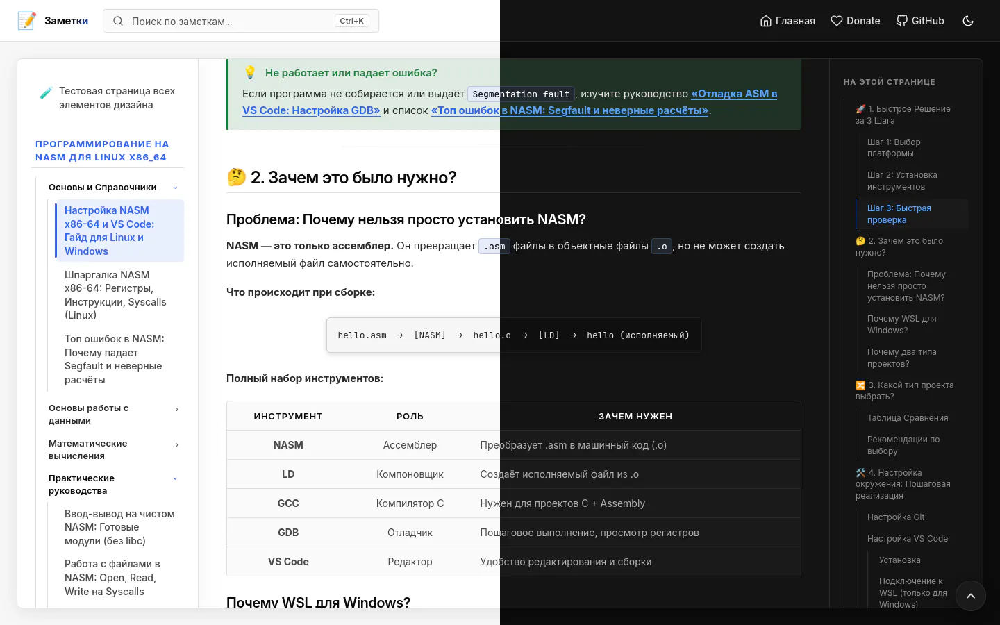

<h3 align="center">biforma</h3>

<p align="center">
    <strong>
    A minimal, fast, and feature-rich dual-mode Hugo theme for documentation and blogging.
    </strong>
</p>
<p align="center">
    <a href="https://gohugo.io">
        
    </a>
    <a href="#license">
        
    </a>
</p>
<p align="center">
    <a href="#features">Features</a> •
    <a href="#quick-start">Quick Start</a> •
    <a href="#configuration">Configuration</a> •
    <a href="#front-matter">Front Matter</a> •
    <a href="#shortcodes">Shortcodes</a> •
    <a href="#license">License</a>
</p>
<hr>

<br>
<p align="center">
  
</p>
<br>

## Features

- **Dual Mode (`themeMode`)**: Switch between `docs` (tree navigation, Table of Contents, category filters) and `blog` (clean post feed, metadata).
- **Multilingual & i18n**: Built-in internationalization with localized UI strings and an optional header language switcher for multi-language sites.
- **Performance First**: Zero-FOUC dark/light theme toggle, local variable fonts (*Inter*, *JetBrains Mono*), and lazy-loaded analytics.
- **Instant Search**: Powered by Pagefind for zero-config, ultra-fast client-side search.
- **Math & Typography**: Built-in KaTeX math rendering, Chroma syntax highlighting, side-by-side code comparison, tabs, and admonitions.
- **Enhanced Media**: Auto-calculated image dimensions (prevents CLS) and built-in image zoom lightbox.
- **Zero Bloat**: Modular CSS/JS bundle compilation — loads only the assets needed for each specific page.

## Quick Start

### Installation

Add `biforma` as a Git submodule to your Hugo site:

```bash
git submodule add https://github.com/b1sted/biforma.git themes/biforma
```

### Search Indexing

Generate the search index after building your site:

```bash
hugo --gc --minify
npx pagefind --site public
```

---

## Configuration

Add the following options to your `hugo.toml`:

```toml
baseURL = "https://example.com"
title = "My Site"
theme = "biforma"

# Optional Multilingual Configuration
defaultContentLanguage = "ru"

[languages]
  [languages.ru]
    label = "Русский"
    weight = 1

  [languages.en]
    label = "English"
    weight = 2

[params]
  # Select theme mode: "docs" or "blog"
  themeMode = "docs"

  logo = "📝"
  description = "Notes & Technical Documentation"
  author = "Your Name"

  # Navigation & Links
  mainSite = "https://example.com"
  github = "https://github.com/b1sted"
  donate = "https://cloudtips.ru/..."  # Adds donate buttons & article support block
  searchPlaceholder = "Search..."

  # Analytics (Lazy-loaded for 100/100 Lighthouse performance)
  googleAnalytics = "G-XXXXXXXXXX"
  yandexMetrika = 12345678

  # Verification Meta Tags
  googleVerification = "your-google-verification-code"
  yandexVerification = "your-yandex-verification-code"

  # Sidebar customization
  [params.sidebar]
    generalTitle = "General"           # Rename root section (default: "Общее")
    hideGeneralTitle = false           # Set true to hide root section title
```

---

## Front Matter

Supported page parameters in Markdown headers:

```yaml
---
title: "Article Title"
description: "Brief summary of the article"
icon: "🚀"           # Emoji icon displayed in cards and sidebar
group: "Getting Started" # Group notes into collapsible sections & filters
group_description: "Core guides for beginners"
difficulty: "Easy"   # Difficulty level displayed on article cards
math: true           # Enable KaTeX math rendering ($E = mc^2$)
toc: true            # Enable/disable Table of Contents sidebar
searchHidden: false  # Exclude page from Pagefind search & search engines
---
```

---

## Shortcodes

- **Admonitions (`admonition.html`)**:  
  `Content`  
  *(Types: `note`, `tip`, `warning`, `danger`)*

- **Custom Code Block (`code.html`)**:  
  `code`  
  *(Options: `noheader="true"`, `center="true"`)*

- **Code Compare (`compare.html`, `compare-left.html`, `compare-right.html`)**:  
  ```markdown
  
    old code
    new code
  
  ```

- **Tabs (`tabs.html`)**:  
  ```markdown
  
  // C++ code
  <!-- tab -->
  // Rust code
  
  ```  
  *(Use `style="content"` for Markdown content tabs)*

- **Dividers (`divider.html`)**:  
  `` *(Types: `dots`, `decorated`, `section`, `thin`)*

- **Images (`img.html`)**:  
  ``

- **RSS Feeds Grid (`rss-feeds.html`)**:  
  `` — renders an interactive grid of RSS links for all site sections.

---

## License

Distributed under the **GNU General Public License v3.0**.

The GPL applies strictly to the source code, templates, and styling of this theme. Site content created using Biforma remains the exclusive property of its respective author under their chosen license.

Full text of the license: [LICENSE](./LICENSE).
